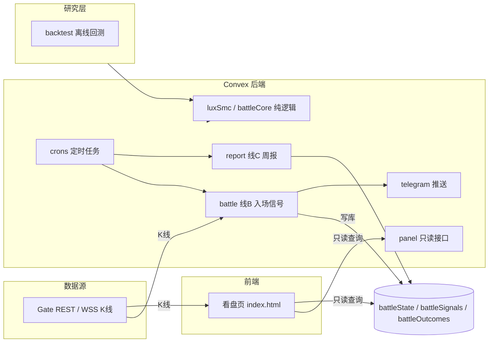

# 系统架构

## 概述

猎场 Vantage 采用「静态前端 + Serverless 后端」结构：

- 前端是零构建的单文件静态页，托管在 GitHub Pages，通过 HTTPS 直接调用 Convex 的 HTTP API。
- 后端是 Convex 部署（prod 环境 `efficient-cod-911`），承担定时扫描、结构化数据存储、Secret 托管与对外读写接口。
- 判定逻辑（`luxSmc`、`battleCore`）是无 Convex 依赖的纯 TypeScript 模块，被后端、看盘页只读接口、回测三方复用。

选择 Convex 的原因：需要一个常驻 cron 来定时拉行情并推送告警，同时把信号与了结结果持久化以供前端查询与周报统计。GitHub Pages 只能提供静态文件，无法定时任务与写库。

## 分层



## 数据流

1. **看盘（读）**：看盘页从 Gate 拉 K 线渲染图表；SMC 叠加与作战面板读数通过 `panel:analyze`、`panel:battleStatus` 在 Convex 侧按同一套纯逻辑复算后返回。
2. **信号（写 + 推）**：`crons` 每分钟触发 `battle.scan` → 拉 Gate K 线 → `evaluateBattle` 判定 → 命中则写 `battleSignals`、更新 `battleState`、推送 Telegram；了结时写 `battleOutcomes` 并回填信号记录。
3. **周报（聚合 + 推）**：`crons` 每周一 01:00 UTC 触发 `report.weeklyReport` → 读 `battleSignals` 近 7 天 → 计算指标与归因 → 推送 Telegram。

## 技术选型

| 领域 | 选型 | 说明 |
| --- | --- | --- |
| 后端运行时 | Convex | 定时任务、数据库、Secret、HTTP 接口一体 |
| 前端图表 | lightweight-charts | CDN 引入，多窗格 K 线 |
| 前端形态 | 单文件静态页 | 无构建步骤，GitHub Pages 托管 |
| 语言 | TypeScript | `strict`，`Bundler` 解析 |
| 回测 | tsx + 本地缓存 | 复用生产纯逻辑 |
| 通知 | Telegram Bot API | 仅通知 |

## 目录结构

```
convex/                后端（Convex）
  schema.ts            数据表定义
  crons.ts             定时任务
  battle.ts            线B：扫描、入库、了结、只读查询
  battleCore.ts        作战面板纯逻辑（判定、风控、消息渲染）
  luxSmc.ts            SMC / lux 结构计算纯逻辑
  panel.ts             看盘页只读接口（analyze / battleStatus）
  report.ts            线C：周报数据与推送
  gate.ts              时段 / 时间 / 价格格式化工具
  exchanges.ts         Gate 行情适配（K线获取与归一化）
  telegram.ts          Telegram 推送封装
backtest/              离线回测（非生产）
  history.ts           Gate 历史拉取 + 本地缓存
  battle.ts            复用生产 evaluateBattle 的回测
market-dashboard/      前端看盘页（静态）
  index.html
docs/business-logic/   业务逻辑总览
.github/workflows/     Pages 发布工作流
```

## 运行时拓扑

- **后端**：Convex 云部署，`BATTLE=1` 时启用告警链路；包含数据库与 cron。
- **前端**：GitHub Pages（`build_type=workflow`），发布 `market-dashboard/`。
- **Secrets**：存于 Convex 环境变量，本地存于 `.env.local`（已 gitignore）。

## 数据表概览

| 表 | 用途 | 索引 |
| --- | --- | --- |
| `battleState` | 每 (交易所:标的) 的布防状态与未了结信号 | `by_key` |
| `battleSignals` | 已推送的入场信号及了结回填 | `by_sigTs` |
| `battleOutcomes` | 信号了结记录（止损 / 止盈 / 取消） | `by_closedTs` |

## 定时任务

| 名称 | 频率 | 调用 |
| --- | --- | --- |
| battle signal | 每分钟 | `internal.battle.scan` |
| signal weekly report | 每周一 01:00 UTC | `internal.report.weeklyReport` |

## 环境变量

| 变量 | 用途 |
| --- | --- |
| `TELEGRAM_BOT_TOKEN` | Telegram 机器人令牌 |
| `TELEGRAM_CHAT_ID` | 推送目标会话 |
| `BATTLE` | 置 `1` 启用告警链路（prod） |
