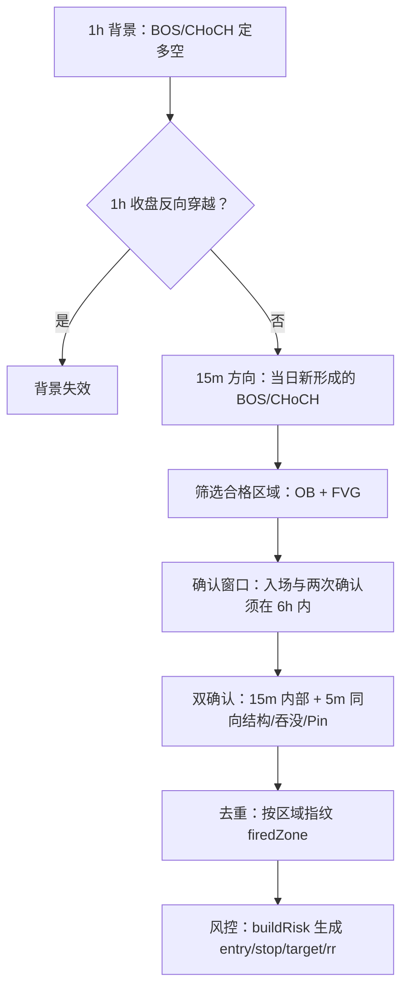

# 作战面板（battle）

作战面板是系统的核心信号链路：在 SMC 结构给出的合格区域内，等待低周期同向确认后产生一次「入场信号」，并把信号持久化与推送到 Telegram。

判定入口为 `evaluateBattle`（`convex/battleCore.ts`），是纯函数；后端 `battle.scan`、看盘页 `panel.battleStatus`、回测三处共用同一实现。

## 判定流程

1. **1h 背景（HTF）**：用 `SWING_LEN` 跑结构，取末段趋势作为多空背景；若最近一根 1h K 收盘反向穿越，则背景失效。
2. **15m 方向（MTF）**：收集当日起新形成的、与背景同向的内部结构突破（BOS / CHoCH），并要求入区处存在位移（dispersion）。
3. **区域筛选**：在方向侧取未缓解的订单块（OB）与公允价值缺口（FVG），过滤掉缺乏位移的区域，并去重。
4. **确认窗口**：入区、确认 1、确认 2 三者须落在 `ZONE_WINDOW_SEC`（6h / 24 根 5m）之内，且区域在窗口内未被反向失效。
5. **双确认**：15m 内部结构确认（回调结束）配 5m 同向确认（结构突破 / 吞没 / Pin Bar），二者索引间距不超过 `CONFIRM_SPAN_MAX`（6 根，30m）。
6. **去重**：用区域指纹 `firedZone` 记录已推送区域，离开后重进才允许再推。
7. **风控**：`buildRisk` 以区域边缘为入场，远端边缘外扩 `STOP_BUF_ATR × ATR` 为止损，取首个满足 `TARGET_MIN_RR` 的流动性位作止盈。

## 关键常量

| 常量 | 值 | 含义 |
| --- | --- | --- |
| `HTF` / `MTF` / `LTF` | 1h / 15m / 5m | 三周期 |
| `SWING_LEN` / `INTERNAL_LEN` | 8 / 4 | 摆动 / 内部结构长度 |
| `ZONE_WINDOW_BARS` / `ZONE_WINDOW_SEC` | 24 / 21600 | 确认窗口（6h） |
| `CONFIRM_SPAN_MAX` | 6 | 两次确认最大间距（30m） |
| `ZONE_BUF_ATR` | 0.15 | 入区判定缓冲（ATR 倍数） |
| `STOP_BUF_ATR` | 0.2 | 止损外扩（ATR 倍数） |
| `DISP_WINDOW` / `DISP_MULT` | 10 / 1.5 | 位移检测窗口 / 阈值 |
| `SWEEP_LOOKBACK` | 20 | 流动性扫荡回溯根数 |
| `TARGET_MIN_RR` | 2 | 止盈最小盈亏比 |

## 状态机

`battleState` 记录每个 `交易所:标的` 的布防状态：

- `firedZone`：最近已推送区域指纹；空串表示可重新布防。
- `zoneKey`：当前跟踪的区域指纹。
- `zoneStartT`：确认窗口起点（首次入区的 5m K 开盘时间）。
- `openDir` / `openEntry` / `openStop` / `openTarget` / `openTs` / `openSignalId`：未了结信号。

信号了结在扫描中检测：收盘穿过止损 → `stop`，触及止盈 → `target`，被新信号取代 → `cancel`。结果写入 `battleOutcomes` 并回填 `battleSignals`。

## 触发开关

仅当部署环境 `BATTLE=1`（prod）时，`battle.scan` 与 `report.weeklyReport` 才真正执行。
