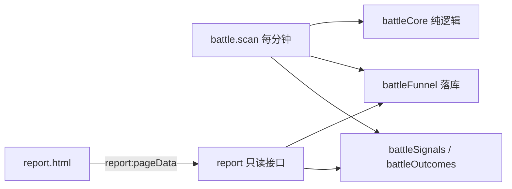

# 猎场信号面板报表页

Feature Name: battle-report-page
Updated: 2026-10-16

## Description

把猎场信号面板的绩效复盘从 Telegram 周报改为独立静态页 `report.html`，并以模拟账户口径（本金 100 USDT、名义 500 USDT、杠杆 100x、每笔保证金 5 USDT、双边 taker 0.05%）输出：分层通过率漏斗、期望值、R 倍数分布、周 / 月回撤，以及逐笔仓位 / 杠杆 / 保证金 / 手续费与账户权益曲线。

入口判定与风控（`buildRisk`）保持不变。

## Architecture

- **采集侧**：`battle.scan` 在评估区域时，把每个区域的生命周期推进写入新表 `battleFunnel`。
- **读取侧**：新增 `report:pageData` 只读查询，一次性返回页面所需聚合数据。
- **展示侧**：`market-dashboard/report.html` 调用 `pageData` 渲染。
- **移除侧**：删除 `weeklyReport` internalAction 与 `signal weekly report` cron。

## Components and Interfaces

### 1. 层级采集（`convex/battleCore.ts` + `convex/battle.ts`）

- `battleCore.evaluateBattle` 增加返回 `funnel` 字段：`{ zoneKey, status, stageTs }`，描述该区域在本次评估推进到的层级。判定顺序沿用现有逻辑：入区 → 确认1 → 确认2 → 入场；窗口内反向穿越远端边界记为 `invalid`。
- `battle.ts` 新增内部函数 `recordFunnel(ctx, event)`：按 `zoneKey` upsert `battleFunnel`（存在则补对应层级时间戳，不存在则插入），保证同区域同层级只落一次。

### 2. 报表接口（`convex/report.ts`）

- `pageData`（query）
  - args：`{ days: number }`（默认 7）
  - 返回：
    - `range: { since, until }`
    - `funnel: { entered, c1, c2, confirmed, invalid, rates: {...} }`
    - `metrics: { n, wins, losses, winRate, expR, sumR, expUsd, sumUsd }`
    - `rBuckets: { label, count }[]`
    - `attribution: { dim, label, n, expR }[]`
    - `drawdown: { week: {mddR, mddPct, mddUsd}, month: {...} }`
    - `account: { principal, notional, leverage, margin, feePerTrade, equity: number[] }`
    - `trades: { symbol, dir, entry, stop, exit, notional, leverage, margin, fee, riskUsd, riskPct, pnlUsd, rNet, openedTs, closedTs }[]`
- 数据来源：`battleSignals`（`by_sigTs`）、`battleOutcomes`（`by_closedTs`）、`battleFunnel`（`by_ts`）。只读。

### 3. 报表页（`market-dashboard/report.html`）

- 单文件静态页，复用看盘页的 Convex HTTP 调用封装（`POST /api/query`）。
- 区块：时间窗口切换（7 / 30 天）、账户概览、漏斗、绩效、R 分布、归因、回撤、逐笔明细。
- 图表可选沿用 `lightweight-charts`（权益曲线）；其余用轻量 DOM 渲染。

### 4. 移除周报推送（`convex/crons.ts`、`convex/report.ts`）

- 删除 `signal weekly report` cron 与 `weeklyReport` internalAction。
- 保留 `battle.scan` 的入场信号 Telegram 推送（`telegram.ts` 不动）。

## Data Models

### battleFunnel（新表）

| 字段 | 类型 | 说明 |
| --- | --- | --- |
| `key` | string | `交易所:标的` |
| `exchange` / `symbol` | string | 来源 |
| `zoneKey` | string | 区域指纹，唯一标识一次布防 |
| `zoneStartT` | number | 入区所在 5m K 开盘时间 |
| `enteredTs` | number | 入区时间 |
| `c1Ts` | optional(number\|null) | 确认1 达成时间 |
| `c2Ts` | optional(number\|null) | 确认2 达成时间 |
| `confirmedTs` | optional(number\|null) | 入场（信号）时间 |
| `invalidTs` | optional(number\|null) | 失效时间 |
| `updatedAt` | number | 更新时间 |

索引：`by_zone`（`zoneKey`）、`by_ts`（`zoneStartT`）。

漏斗计数：`entered = 行数`；`c1 = count(c1Ts!=null)`；`c2 = count(c2Ts!=null)`；`confirmed = count(confirmedTs!=null)`；`invalid = count(invalidTs!=null)`；各层通过率 = 该层数 / 上一层数。

### 账户口径常量

| 项 | 值 |
| --- | --- |
| 本金 `principal` | 100 USDT |
| 名义 `notional` | 500 USDT |
| 杠杆 `leverage` | 100x |
| 保证金 `margin` | 5 USDT |
| 单边 taker | 0.05% |
| 每笔手续费 `feePerTrade` | 500 × 0.0005 × 2 = 0.5 USDT |

### 逐笔派生量

- `riskUsd = notional × |entry-stop| / entry`
- `riskPct = riskUsd / principal`
- `pnlUsd = tradeR × riskUsd − feePerTrade`
- `rNet = pnlUsd / riskUsd`
- 权益曲线 = 按 `closedTs` 累加 `pnlUsd`；回撤在该曲线上取最大回落。

## Correctness Properties

1. `battleFunnel` 对同一 `zoneKey` 至多一行；层级时间戳单调：`enteredTs ≤ c1Ts ≤ c2Ts ≤ confirmedTs`。
2. `confirmed` 数不超过 `battleSignals` 在窗口内的去重区域数。
3. 回撤恒为非负；窗口内无了结交易时回撤为 0。
4. 报表接口为纯读，调用前后 `battle*` 表不变。
5. 期望值、R 分布与回撤均基于扣费后的 `pnlUsd`。

## Error Handling

- `pageData` 在 `days` 非法（≤0）时按默认 7 处理。
- 报表页在接口失败或超时时显示错误占位，不白屏。
- `recordFunnel` upsert 冲突时以已存在行为准，仅补空缺层级。
- 删除周报 cron 前，先确认 prod 无其他调用方依赖 `report.weeklyReport`。

## Test Strategy

- **纯逻辑单测**：`rBuckets` 分桶、回撤计算、账户派生量用构造交易样例断言。
- **接口回归**：对 `pageData` 在空库与有数据两种情形断言结构完整、数值有限。
- **采集验证**：用回测/本地 dev 触发 `battle.scan`，核对 `battleFunnel` 单调性与去重。
- **页面冒烟**：本地静态服务 + prod Convex，检查渲染与错误态。
- **不影响生产**：确认 `battle.scan` 的 TG 信号推送与 `buildRisk` 行为不变。

## References

[^1]: (Filenames#Lnnn) - convex/report.ts（现有周报实现）
[^2]: (Filenames#Lnnn) - convex/battle.ts（扫描与入库）
[^3]: (Filenames#Lnnn) - convex/battleCore.ts（判定纯逻辑）
[^4]: (Filenames#Lnnn) - convex/schema.ts（数据表）
[^5]: (Filenames#Lnnn) - market-dashboard/index.html（前端与 Convex 调用封装）
