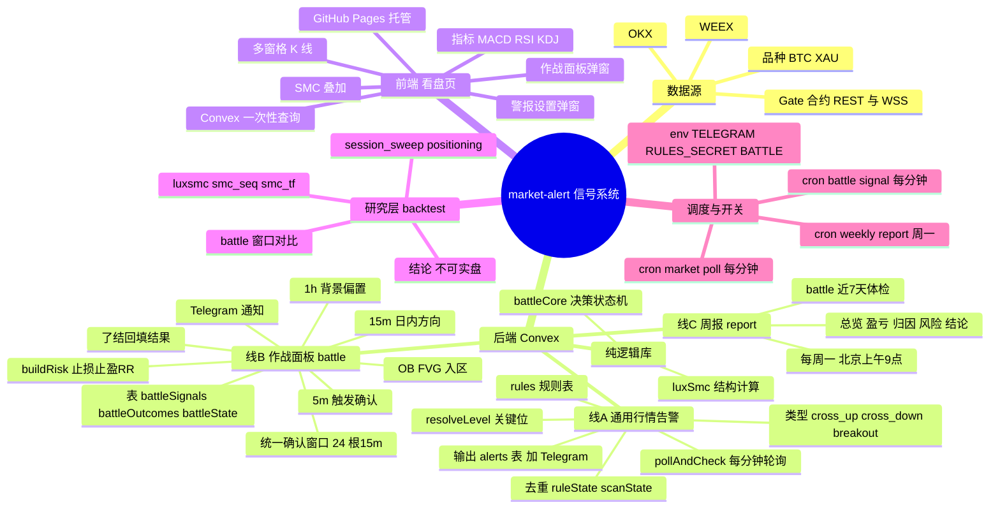

# market-alert 业务逻辑总览

> 更新日期：2026-10-16
> 定位：Gate 合约行情看盘 + Telegram 告警。盯 BTC / XAU 两个品种，图表给前端，信号推手机。

## 思维导图

## 1. 分层总览

| 层 | 模块 | 关键内容 | 说明 | 代码位置 |
|---|---|---|---|---|
| 数据源 | Gate | REST 历史 + WSS 实时（主用） | 作战面板只用 gate | `convex/exchanges.ts:21` |
| 数据源 | WEEX / OKX | REST | 仅告警规则可选 | `convex/exchanges.ts` |
| 数据源 | 品种 | BTC、XAU | 只做这两个 | `convex/exchanges.ts:16` |
| 后端 | 线A 通用告警 | 用户规则轮询推送 | 见下表 2 | `convex/alerts.ts` |
| 后端 | 线B 作战面板 battle | 唯一入场信号 | 见下表 3 | `convex/battle.ts` |
| 后端 | 线C 周报 | battle 近 7 天体检 | 周一推送 | `convex/report.ts` |
| 后端 | 纯逻辑库 | luxSmc / battleCore | 无 Convex 依赖，回测共用 | `convex/luxSmc.ts`、`convex/battleCore.ts` |
| 后端 | 看盘只读接口 | panel:analyze / panel:battleStatus | 看盘页唯一计算入口 | `convex/panel.ts` |
| 前端 | 看盘页 | 单文件静态页 | 计算走后端 panel:*，见下表 6 | `market-dashboard/index.html` |
| 研究层 | backtest | 策略验证 | 不产线，见下表 7 | `backtest/*.ts` |
| 调度 | crons + env | 3 个定时任务 + 开关 | 见下表 5 | `convex/crons.ts` |

## 2. 线A 通用行情告警

| 项 | 内容 | 代码位置 |
|---|---|---|
| 规则存储 | `rules` 表 | `convex/schema.ts` |
| 规则类型 | `cross_up` / `cross_down` / `breakout` | `convex/rulesAdmin.ts` |
| 关键位 | breakthrough 取前一已结束时段 high/low；cross 取固定 price | `convex/gate.ts:241` `resolveLevel` |
| 轮询 | 每分钟，cross 用 1m、breakout 用 15m 收盘 | `convex/alerts.ts:49` `pollAndCheck` |
| 突破判定 | 实体收盘=body、影线=wick，各推一次 | `convex/gate.ts:295` `scanBreakout` |
| 去重状态 | `ruleState`（side/level/wickDone）、`scanState`（已处理 K） | `convex/market.ts` |
| 输出 | 写 `alerts` 表 + Telegram | `convex/alerts.ts:14` |
| 写入口令 | `RULES_SECRET` | `convex/rulesAdmin.ts` |

## 3. 线B 作战面板 battle（入场信号）

| 步骤 | 内容 | 常量 | 代码位置 |
|---|---|---|---|
| 1 背景 | 1h 结构定 bull/bear/range，反向收盘作废 | `HTF.swing=8` | `battleCore.ts:420` |
| 2 方向 | 15m 摆动 BOS/CHoCH，须日内且带位移 | `DISP_MULT=1.5` | `battleCore.ts:441` |
| 3 入区 | 价格进入顺向 15m OB/FVG | `ZONE_BUF_ATR=0.15` | `battleCore.ts:483` |
| 4 窗口 | 统一确认窗口，5m 收盘穿远端即失效 | `ZONE_WINDOW_BARS=24` | `battleCore.ts:475` |
| 5 确认 | 确认1=15m 内部结构；确认2=5m 触发；须同窗且索引差≤span | `CONFIRM_SPAN_MAX=6` | `battleCore.ts:499` |
| 6 去重 | 同区域当天只推一次 | `firedZone` | `battleCore.ts:505` |
| 7 风控 | entry/stop/target/RR；target 取 RR≥2 的最近对手流动性 | `TARGET_MIN_RR=2`、`STOP_BUF_ATR=0.2` | `battleCore.ts:311` `buildRisk` |
| 落库 | `battleSignals`、`battleOutcomes`、`battleState` | | `convex/battle.ts` |
| 了结回填 | long 收盘≤stop 或最高≥target（short 反向），patch 信号 + 写 outcome | | `convex/battle.ts` `scan` |
| 推送 | 每个新信号一条 Telegram（仅通知） | | `convex/battle.ts` |
| 开关 | `BATTLE=1`（仅 prod） | | `convex/battle.ts` |

## 4. 线C 周报

| 项 | 内容 | 代码位置 |
|---|---|---|
| 数据源 | `battleSignals` 近 7 天（仅 battle） | `convex/report.ts` `reportData` |
| 内容 | 总览 / 按日盈亏(R+%) / 分标的 / 归因(方向·触发·区域) / 风险指标 / 结论建议 | `convex/report.ts` `weeklyReport` |
| 口径 | 止损=-1R；未了结只计数；样本 n<10 提示 | `convex/report.ts` |
| 触发 | cron 周一 01:00 UTC（北京 09:00） | `convex/crons.ts` |
| 手动 | `npx convex run report:weeklyReport --prod` | |

## 5. 数据表 / 定时任务 / 开关

| 类型 | 名称 | 用途 |
|---|---|---|
| 表 | `rules` / `ruleState` / `scanState` | 告警规则与去重 |
| 表 | `alerts` | 已触发告警 |
| 表 | `battleSignals` / `battleOutcomes` / `battleState` | 信号 / 了结 / 布防 |
| cron | `market poll`（1m） | 通用告警轮询 |
| cron | `battle signal`（1m） | 作战面板扫描 |
| cron | `signal weekly report`（周一） | 周报 |
| env | `TELEGRAM_BOT_TOKEN`、`TELEGRAM_CHAT_ID` | 推送 |
| env | `RULES_SECRET` | 规则写入口令 |
| env | `BATTLE`（prod=1） | 作战面板开关 |

## 6. 前端看盘页

| 功能 | 内容 |
|---|---|
| 图表 | 多窗格 K 线（lightweight-charts），交易所 REST 历史 + WSS 实时 |
| 叠加 | BOS/CHoCH、OB、FVG、扫单、时段框（数据来自 `panel:analyze`） |
| 指标 | MACD、RSI、KDJ 及指标注册表 |
| 弹窗1 | 警报（只读最近触发，规则管理不在看盘页） |
| 弹窗2 | SMC 作战面板（日内方向、最近信号、最近了结、检查清单；读数来自 `panel:battleStatus`） |
| 数据 | 一次性 HTTP POST，硬编码 prod Convex URL（非订阅/非轮询） |
| 托管 | GitHub Pages，push `master` 且改 `market-dashboard/**` 触发 |

## 7. 回测

| 脚本 | 用途 |
|---|---|
| `backtest/battle.ts` | 用生产同口径 `evaluateBattle` 复算作战面板 |
| `backtest/history.ts` | 共享：Gate 历史分页 + 缓存 |

原研究层脚本（`luxsmc`/`run`/`smc_seq`/`smc_tf`/`session_sweep`/`positioning`）与生产策略无关，已于 2026-10-16 移除。

## 8. 作战面板回测验收（2026-10-16）

工具 `backtest/battle.ts`（复用生产 `evaluateBattle`；MTF 15m / LTF 5m；前瞻 24h；net 已扣 10bps 往返）。
样本 Gate `BTC`/`XAU` 5m 近 ~31 天（09-14 → 10-15）。生产口径 = 窗口 24 根 15m、span 6。

| 指标 | 值 |
|---|---|
| 成交 | 21（BTC 8 / XAU 13） |
| 胜率 | 71%（15 胜 / 6 负） |
| 净期望 | +1.63 R/笔 |
| 累计净 | +34.28 R |
| 前半段 | 10 笔，70% 胜，+14.38 R |
| 后半段 | 11 笔，73% 胜，+19.90 R |

参数敏感性（同一样本）：窗口 8/12/24 × span 3/6/9 净期望均为正（+0.76～+1.63 R/笔），仅 XAU 窗口 8 略负（-0.06 R/笔，n=4）。

结论：生产 battle 组合（位移过滤 + 双层确认 + 结构止损/流动性止盈）在近 1 个月、扣成本、时间前后半段各自为正。旧结论「SMC 变体均不可实盘」测的是泛化变体，本次测的是生产组合口径，两者不矛盾。

局限：样本仅 ~31 天 / 21 笔（Gate 5m 历史上限）；止盈取最近对手流动性，收益集中于少数远目标（rr 均值 4.7、最大 13.1）；止损按 -1R 记账、未含跳空滑点，略偏乐观。待办：更长样本 / 多市场状态复核。
